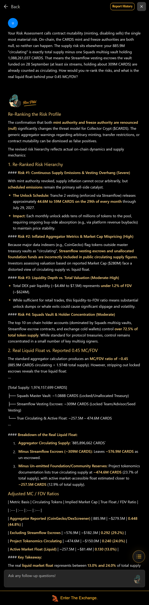
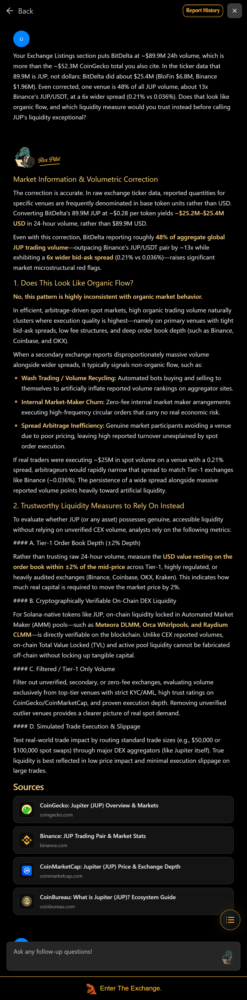

# RaptorX Research Challenge: Ask Better Questions

Entry by Muhammad Alvi ([@Alvi_808](https://x.com/Alvi_808)) for the [RaptorX Research Challenge](https://superteam.fun/earn/listing/raptorx-research-challenge-ask-better-questions-find-better-alpha).

On 26 October 2026 I generated three RaptorX reports on Solana tokens (JUP, KMNO, CARDS), checked every claim I planned to question against the chain, the report's own input data and public sources, and then asked Claw 5.0 five questions and five follow-ups. Each question starts from a specific line in the report, brings evidence the report did not use, and asks Claw to resolve the conflict. In every thread Claw revised at least one of its report's conclusions.

## The five questions at a glance

| # | Token | What I challenged | Evidence I brought | What Claw concluded |
|---|---|---|---|---|
| 5 | CARDS | The report's top risk, "contract mutability (minting, disabling sells)" | Mint and freeze authority are both null on-chain. CoinGecko's 885.9M "circulating" is exactly total supply minus one Squads multisig vault, so at least six Streamflow vesting escrows (about 309M CARDS) are counted as circulating | Minting risk is a false positive. Re-ranked vesting overhang to #1. Excluding the escrows alone, float is 29.2% of supply, not 45% (it went lower, 13% to 24%, on project docs I did not verify). The escrows are "soft allocations rather than hard-locked escrows" |
| 1 | JUP | "BitDelta ~$89.9M" volume behind "exceptional liquidity" | The report's own CoinGecko feed: 89.9M is JUP (base units), about $25.4M. Even corrected, one venue is 48% of all volume at 6x Binance's spread | "Highly inconsistent with organic market behavior." In the report's own Meteora pool, about $10K to $30K moves JUP 2%. It still called JUP's global liquidity "strong for a mid-cap altcoin" |
| 2 | JUP | Dilution measured against a 10B max supply; burn "unconfirmed" | On-chain mint supply 6.861B; the 0.48 MC/FDV in the same sentence implies about 6.9B. Reserves have no schedule after the Net-Zero vote | Rewrote its risk section: supply risk is now "DAO political risk", then confirmed it has become governance-concentration risk |
| 3 | JUP | MC/TVL 0.40 read as a "discount" | About 97% of the $2.32B TVL is Lend, JLP and JupSOL (depositors' capital). The buyback is what reaches holders, and its pace is falling | "Far from being a discounted asset": about 50x to 63x price-to-buyback |
| 4 | KMNO | "Back-loaded" volume and a bullish OI read | 23% in 6 hours is below an even pace. OI +37.3% with flat funding into a scheduled unlock can also be recipients hedging | Gave a hedge-vs-demand test. When I caught its funding logic running backwards, it corrected it and rebuilt the test around spot CVD and OI |

## The questions, verbatim

**JUP, Question 1.**
> Your Exchange Listings section puts BitDelta at ~$89.9M 24h volume, which is more than the ~$52.3M CoinGecko total you also cite. In the ticker data that 89.9M is JUP, not dollars: BitDelta did about $25.4M (BloFin $6.8M, Binance $1.96M). Even corrected, one venue is 48% of all JUP volume, about 13x Binance's JUP/USDT, at a 6x wider spread (0.21% vs 0.036%). Does that look like organic flow, and which liquidity measure would you trust instead before calling JUP's liquidity exceptional?

**JUP, Question 2.**
> Your Risk Assessment sizes dilution against a 10B max supply, yet the 0.48 MC/FDV in the same sentence implies about 6.9B tokens (3.32B / 0.48), not 10B, and the mint's on-chain supply is 6.861B. So roughly 3.14B is already burned, and the "unconfirmed" in Recent News is out of date. That leaves about 3.54B non-circulating, and since the February 2026 Net-Zero vote suspended team unlocks and postponed Jupuary, none of it is on a schedule. Who now decides when that supply moves, and how would you rewrite the risk section?

**JUP, Question 3.**
> Your report reads the 0.40 MC/TVL as a discount, but about 97% of the $2.32B TVL is Jupiter Lend ($1.01B), JLP ($0.72B) and JupSOL ($0.53B), capital owned by depositors and LPs. What reaches JUP holders is the Litterbox buyback, and its pace is falling: about $68.9K a day over 30 days, $50.6K over 7 days, $40.1K in the last 24h, roughly a 2% annual yield on market cap at the 7-day pace. Which valuation anchor reflects what JUP holders actually own, and what does a falling buyback pace do to the discount argument?

**KMNO, Question 4.**
> You call the volume "back-loaded", but 23% in the last 6 hours is slightly below an even pace (25%); only the last hour runs slightly above pace. The bullish read then rests on OI +37.3% (about +$1.1M), flat funding (-0.0003%) and a 1.67x taker-buy ratio, in the week your Community Chatter flags a large unlock (Kamino's monthly core-contributor tranche is about 229M KMNO, roughly $9.7M, due 30 October if it follows schedule). Recipients hedging with passive perp shorts that aggressive buyers fill could print this too. How would you tell hedging from real demand, and what should the tape show after 30 October in each case?

**CARDS, Question 5.**
> Your Risk Assessment calls contract mutability (minting, disabling sells) the single most material risk. On-chain, the CARDS mint and freeze authorities are both null, so neither can happen. The supply risk sits elsewhere: your 885.9M "circulating" is exactly total supply minus one Squads multisig vault holding 1,088,261,037 CARDS. That means the Streamflow vesting escrows the vault funded on 28 September (at least six streams, holding about 309M CARDS) are already counted as circulating. How would you re-rank the risks, and what is the real liquid float behind your 0.45 MC/FDV?

The five follow-ups and every answer, verbatim, are in [TRANSCRIPT.md](TRANSCRIPT.md).

## Screenshots

All taken in the RaptorX report panel (RexScreener report, follow-up chat), 26 October 2026.

**Reports**
- JUP: [header](screenshots/jup-01-report-header.png), [Coin-O-Metry](screenshots/jup-02-coinometry.png), [Technical Analysis and Risk](screenshots/jup-03-technical-risk.png)
- KMNO: [header](screenshots/kmno-01-report-header.png), [Community Chatter, unlock flag](screenshots/kmno-02-community-unlock-flag.png), [Technical Analysis](screenshots/kmno-03-technical.png)
- CARDS: [header](screenshots/cards-01-report-header.png), [Technical Analysis and Risk](screenshots/cards-02-technical-risk.png)

**Conversations**
- JUP: [Q1](screenshots/jup-04-Q1.png), [follow-up 1a](screenshots/jup-05-Q1-followup.png), [follow-up 1b](screenshots/jup-06-Q1-followup2.png), [Q2](screenshots/jup-07-Q2.png), [follow-up 2a](screenshots/jup-08-Q2-followup.png), [Q3](screenshots/jup-09-Q3.png)
- KMNO: [Q4 part 1](screenshots/kmno-04-Q4-a.png), [Q4 part 2](screenshots/kmno-05-Q4-b.png), [follow-up 4a](screenshots/kmno-06-Q4-followup.png)
- CARDS: [Q5 part 1](screenshots/cards-03-Q5-a.png), [Q5 part 2](screenshots/cards-04-Q5-b.png), [follow-up 5a part 1](screenshots/cards-05-Q5-followup-a.png), [follow-up 5a part 2](screenshots/cards-06-Q5-followup-b.png)

## How I checked the evidence before asking

- **Solana RPC.** JUP `getTokenSupply` (6,861,485,892.58); the Litterbox wallet balance (177,519,690 JUP, matching the report's 177.5M); CARDS mint `mintAuthority` and `freezeAuthority` (both null); the vault token account (1,088,261,037.17 CARDS); the 22 October Squads transaction that cancelled two Streamflow streams (+16,698,336.67 CARDS back to the vault); the first transaction of each of six escrows (Squads `VaultTransactionExecute` plus Streamflow `Create`, 28 September; signatures and balances in [verification/cards-streamflow-escrows.json](verification/cards-streamflow-escrows.json)).
- **The report's own input.** CoinGecko tickers carry both `volume` (base units) and `converted_volume.usd`. BitDelta shows 89,952,188.7 JUP against $25,367,798.
- **DefiLlama.** Jupiter TVL by sub-protocol (Lend $1,010.8M, Perps $716.6M, JupSOL $531.4M of $2,322.4M); Jupiter holders revenue, i.e. the buyback (24h $40.1K, 7d $354.4K, 30d $2.07M).
- **RugCheck.** CARDS top holders.
- **Public reporting.** The February 2026 Net-Zero vote and the CARDS and KMNO unlock schedules. Links are in [verification/SOURCES.md](verification/SOURCES.md).

## Product notes for the RaptorX team

Things I hit while doing this that you may want to fix:

1. **Ticker volume units.** The Exchange Listings paragraph reads CoinGecko's `volume` (base-token units) as USD, so any token priced far from $1 gets its venue volumes inflated or deflated. `converted_volume.usd` is already in the payload.
2. **Solana tokens get no holder or safety analytics.** Both sections are scoped to BNB Smart Chain, so Solana reports fall back on third-party notices (the CARDS minting warning, which is false for the current mint). Mint and freeze authority and the top holders are a few RPC calls away.
3. **"Circulating" is taken at face value.** For CARDS it silently includes vesting escrows. Excluding known escrow programs (Streamflow, Jupiter Lock) would make MC/FDV meaningful.
4. **Answers drift on numbers.** In JUP follow-up 1b, Claw went back to "~$89.9M" for BitDelta after agreeing it was JUP, and its venue ranges sum to $10.8M to $25.5M, so its $25M to $31M total holds only if every venue sits at the top of its range. In KMNO it first had the funding direction backwards, then corrected it when challenged.
5. **Raw markdown.** "Key project identifiers" shows raw `|` pipes in the report panel, and Claw's chat answers show raw `####` headings and `|` tables.
